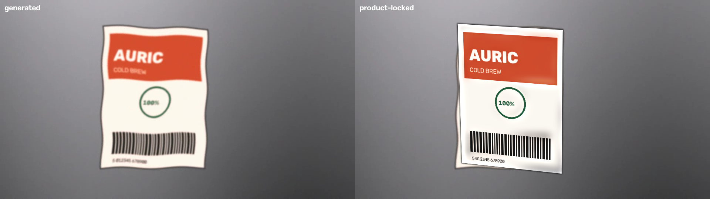

# ComfyUI-ProductLock

Keep a client's real product, packaging and logo pixel-intact through generative video.



Same frame, twice. Left is what the video model produced: wavy pack edges, soft
type, a barcode that no longer scans. Right is the same frame after ProductLock
has tracked the pack and composited the actual approved artwork back onto it.

---

## The problem

Every brand team that has tried generative video has hit the same wall. The
motion is usable. The product isn't.

Diffusion models have no concept of a product as a fixed object. They redraw it
every frame, so the logo breathes, the type softens, the pack silhouette
wobbles, and small print turns to mush. For a car ad that might be survivable.
For an FMCG spot it is fatal, because the artwork on screen is a legal asset:
it has been through brand approval, regulatory review and often trademark
counsel. A logo that is 4% wrong is not a stylistic choice, it is a pack that
cannot be aired.

The result is that AI video stops at the pitch stage. Agencies use it for
mood films and animatics, then shoot the hero product conventionally, because
nobody can sign off frames where the pack is "nearly right".

This node pack is a direct answer to that: let the model do what it is good at
(light, motion, environment, camera) and refuse to let it touch the product.

## How it works

One estimate carries the whole pack: a **homography** mapping the reference
packshot into each frame.

1. **Track.** Detect SIFT (or ORB) features on the approved packshot, match them
   into each generated frame, and fit a homography with RANSAC.
2. **Composite.** Warp the real packshot through that homography and blend it
   over the frame. The warped silhouette *is* the matte, so no segmentation model
   and no extra weights are needed.
3. **QC.** Emit a before/after strip, a drift plot and a numeric report.

Two details do most of the quality work:

- **The matte is eroded, then feathered**, so the seam sits just inside the
  product edge rather than on it.
- **The grade match is low-frequency only.** A heavily blurred copy of the frame
  divided by a heavily blurred copy of the warped packshot gives a gain field.
  Low frequencies carry scene lighting; high frequencies carry logo detail. So
  the pack picks up the shot's light without any of its own detail moving.

### Confidence is not optional

An inlier count alone is a bad trust signal. RANSAC will happily agree on a
geometrically absurd homography when the product has melted, and report a
perfectly healthy 12+ inliers while doing it — measured, that produced **309 px**
corner errors on frames that passed the inlier gate.

So every recovered homography is also checked as a shape: the warped quad must be
convex, wound the same way as the source (no mirroring), within sane area bounds,
and free of degenerate edges. Frames that fail are flagged, not composited.

## Measured results

Accuracy is measured against a **known** homography. The harness moves the
packshot along a synthetic camera path, degrades each frame (soft focus, colour
drift, noise, and a local sinusoidal warp standing in for melting), and the
tracker never sees ground truth. Error is mean corner reprojection error in
pixels — sub-pixel means the composite lands exactly.

24 frames at 960×540, packshot 300×400, SIFT:

| degradation | inlier gate only |  | + geometry check |  |
|---|---|---|---|---|
| | **locked** | **median / max px** | **locked** | **median / max px** |
| 0.00 | 24/24 | 0.37 / 1.19 | 24/24 | 0.37 / 1.19 |
| 0.25 | 24/24 | 1.80 / 3.42 | 24/24 | 1.80 / 3.42 |
| 0.50 | 24/24 | 4.77 / 16.00 | 24/24 | 4.77 / 16.00 |
| 0.75 | 24/24 | 9.63 / 24.08 | 24/24 | 9.63 / 24.08 |
| 1.00 | 24/24 | 23.22 / **309.35** | 23/24 | 22.51 / 137.79 |
| 1.50 | 15/24 | 64.80 / **314.62** | 9/24 | **21.70** / 89.82 |
| 2.00 | 7/24 | 285.10 / **998.84** | **0/24** | — |

The geometry check trades recall for correctness, which is the right trade here:
at the heaviest degradation it composites nothing at all rather than pasting
seven mirrored, collapsed packs into a client deliverable. Failing loudly is the
feature.

**Performance** — 48 frames at 960×540, CPU only (no GPU, no model weights):

| stage | per frame | total |
|---|---|---|
| track | 46.5 ms | 2.23 s |
| composite | 68.0 ms | 3.27 s |
| **total** | **114.5 ms** | **5.50 s** |

## What's in the pack

| Node | Does |
|---|---|
| **Product Lock — Track** | Homography + confidence per frame. Outputs `PRODUCT_TRACK`. |
| **Product Lock — Composite** | Warps the real asset back, feathered, with low-frequency grade match. |
| **Product Lock — QC** | Before/after strip, drift plot, numeric report. |

Kept as three nodes rather than one so each step is inspectable on the canvas —
you can see the track before you trust the composite.

### Workflows

- `workflows/product_lock_kling.json` — packshot → Kling image-to-video → track →
  composite → QC → save. The full demo.
- `workflows/product_lock_byo_footage.json` — same, but starting from a video file
  you already have. **Runs with no API credits and no model downloads.**

## Install

```bash
git clone https://github.com/<you>/ComfyUI-ProductLock custom_nodes/ComfyUI-ProductLock
pip install -r custom_nodes/ComfyUI-ProductLock/requirements.txt
```

Only dependency is OpenCV. There are no model weights to download.

To regenerate the demo assets and reproduce the numbers above:

```bash
python tests/make_demo_assets.py <ComfyUI>/input
python tests/test_tracking.py
```

## Limitations

These are real and worth stating plainly.

1. **It assumes the product face is planar.** A homography maps a plane to a
   plane. Labels, box faces, flat logos and screens are fine. A can rotating past
   its own edge, or a deforming pouch, is not a plane, and the composite will
   slide at the silhouette. This is the single biggest constraint.
2. **Featureless products cannot be tracked.** A plain bottle or a solid-colour
   box gives SIFT nothing to match. The node raises with a clear message rather
   than returning a silent identity transform.
3. **One reference view only.** If the product turns to show a different face,
   the track is lost — correctly, but it is lost.
4. **No occlusion handling.** A hand passing in front of the pack gets painted
   over, because nothing tells the compositor that the pack is behind something.
5. **No temporal reasoning.** Frames are tracked independently, so there is small
   frame-to-frame jitter, and a single bad frame surrounded by good ones is not
   caught. That is exactly how the 137 px outlier at degradation 1.00 survives.
6. **The grade match is global and low-frequency.** It adapts overall lighting.
   It will not reproduce a hard shadow edge falling across the pack, and it
   cannot give the pack a moving specular highlight.
7. **Accuracy figures come from a synthetic harness**, not from a corpus of real
   model output. The degradation model is a reasonable stand-in for how products
   drift, but it is a stand-in.

## What I'd change

In priority order, if this were going into production rather than being a
demonstration:

1. **Temporal filtering of the homography.** The biggest quality win for the
   least work. Fit a smooth path through the per-frame estimates and reject
   outliers against their neighbours instead of judging each frame alone. This
   would have caught the 137 px frame, and would kill the residual jitter.
2. **Occlusion holdout.** Run a segmentation pass for foreground objects and
   subtract them from the product matte, so hands, pours and props sit correctly
   in front of the pack.
3. **Multi-view reference.** Take several packshot angles rather than one, score
   each per frame, and use the best. That is what makes rotating products work.
4. **A deformable warp for non-planar packs.** A cylinder model for cans and
   bottles, driven by the same feature correspondences, instead of a flat
   homography. This is what would move it from "labels and boxes" to "most FMCG".
5. **Export the track.** Emit the per-frame corner-pin so a compositor can take
   the shot further in a real finishing package instead of accepting Comfy's
   composite as final. In practice that is how this lands in a studio pipeline.
6. **Validate against real model output.** Replace the synthetic degradation with
   a labelled set of real generated clips and re-measure. The numbers above would
   change, and I would want to know by how much before quoting them to a client.
